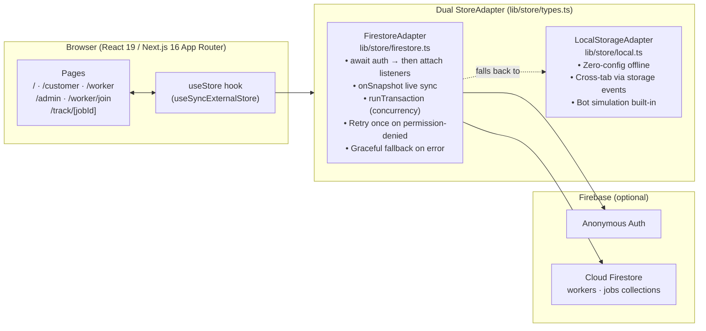

# ⚡ QuickKaam

**Hyperlocal skilled-worker booking for Bharat. Post a job, get a quote, start in 30 minutes.**

> 🚧 **Demo project** — verification badges, identity checks, and ratings are simulated.
> No real money moves. No personal data is stored.

---

## The Problem

Hiring a plumber in suburban Mumbai takes 3–4 phone calls, opaque pricing, and a leap of faith.
QuickKaam flips the script: the **customer names their budget**; nearby workers accept or counter in real time.
Everyone sees the same live status — open → quoted → accepted → in-progress → done → reviewed.

---

## ▶ Live Demo

**[hyperlocal-seven-beige.vercel.app](https://hyperlocal-seven-beige.vercel.app)**

Open in **two tabs** (`/customer` + `/worker`) to see live sync.  
Add `?demo=1` to any URL to unlock the **Admin** tab and **Reset demo data** button.

---

## Architecture



**How the adapter is chosen:**
- `NEXT_PUBLIC_FIREBASE_*` env vars present → `FirestoreAdapter` (real-time, multi-device)
- Vars missing or Firestore permission error → `LocalStorageAdapter` (offline, same-device tabs)
- A `🔌 Demo mode (offline)` chip appears in the header when the fallback is active

---

## 5-Command Setup

```bash
# 1 — Clone
git clone https://github.com/Mohammad-Hassan027/hyperlocal.git
cd hyperlocal

# 2 — Install
npm install

# 3 — (Optional) Firebase — copy and fill in your project keys
cp .env.example .env.local
#   then edit .env.local with your NEXT_PUBLIC_FIREBASE_* values
#   skip this step to run fully offline with the LocalStorageAdapter

# 4 — Dev server
npm run dev        # http://localhost:3000

# 5 — Tests
npm run lint           # 0 errors
npm run test:unit      # 2/2 pass
npm run test:matching  # 6/6 pass
```

---

## Environment Variables

| Variable | Required | Description |
|---|---|---|
| `NEXT_PUBLIC_FIREBASE_API_KEY` | No | Firebase web API key |
| `NEXT_PUBLIC_FIREBASE_AUTH_DOMAIN` | No | `<project>.firebaseapp.com` |
| `NEXT_PUBLIC_FIREBASE_PROJECT_ID` | No | Firestore project ID |
| `NEXT_PUBLIC_FIREBASE_STORAGE_BUCKET` | No | `<project>.firebasestorage.app` |
| `NEXT_PUBLIC_FIREBASE_MESSAGING_SENDER_ID` | No | Firebase messaging sender |
| `NEXT_PUBLIC_FIREBASE_APP_ID` | No | Firebase app ID |

> All six vars are optional. Without them the app runs in full offline demo mode.

**Vercel:** add these in **Project → Settings → Environment Variables** as type **Config** (not Secret — `NEXT_PUBLIC_*` vars are always exposed to the browser by design). Select all three environments (Production, Preview, Development), then trigger a redeploy.

---

## Demo Script (5 steps, ~2 min)

Open **two browser tabs**:

| Tab | URL | Role |
|---|---|---|
| Tab A | `/customer` | Customer |
| Tab B | `/worker` | Worker — Ramesh Yadav (Plumber, w1) |

1. **Tab A — Post a job:**  
   Select *Plumber* → click **Send to everyone nearby** → description: `"Leaking kitchen tap"` → budget `₹350` → **Send request**

2. **Tab B — See it live:**  
   The job appears instantly. Click **Take it for ₹350** (instant accept) or type a counter price and click **Send price**.

3. **Tab A — Accept the offer:**  
   The offer appears live. Click **Accept**. A **4-digit Start Code** appears on screen.

4. **Tab B — Start the job:**  
   Enter the 4-digit code from Tab A → **Verify & Start Job**. Status flips to *In progress*.

5. **Tab B → Tab A — Finish:**  
   Worker clicks **Mark as done** → Customer leaves a ⭐⭐⭐⭐⭐ review.

**Demo tools** (top-right menu): toggle bot workers, change demo speed (1× / 20×), run **Judge Mode** (full 75-second captioned auto-play). Add `?demo=1` to the URL to also see **Reset demo data** and the **Admin** tab.

---

## What is Real vs Mock

| Feature | Status | Notes |
|---|---|---|
| Live job sync between devices | ✅ Real | Firestore `onSnapshot` |
| Auth-before-listeners ordering | ✅ Real | `await ensureAnonymousAuth` before attaching `onSnapshot` |
| Concurrent-accept safety | ✅ Real | Firestore `runTransaction` |
| Anonymous auth | ✅ Real | Firebase Anonymous Auth |
| Permission-denied retry | ✅ Real | Re-auths once, then falls back to local |
| Offline fallback | ✅ Real | `LocalStorageAdapter` with cross-tab events |
| OTP start flow | ✅ Real logic, 🟡 Demo only | 4-digit code generated & verified in-app; no SMS sent |
| Worker identity / ID check | 🟡 Mock | File upload accepted but not stored or verified |
| Background check badges | 🟡 Mock | Admin toggles badges — no real checks run |
| Phone numbers | 🟡 Mock | Masked until accepted; dummy numbers only |
| Payments | ❌ Not implemented | Agreed price shown; no payment gateway |
| SMS / push notifications | 🟡 Simulated | In-app toast only; no real push |
| GPS location | 🟡 Simulated | Worker movement animated between seed points |

---

## Firebase Setup

### 1. Create a Firebase Project
Open [Firebase Console](https://console.firebase.google.com/) → **Add Project** → name it (e.g. `quickkaam-demo`).

### 2. Enable Anonymous Authentication
**Build → Authentication → Get Started → Sign-in method → Anonymous → Enable → Save**

### 3. Create Cloud Firestore
**Build → Firestore Database → Create database** → choose a region (e.g. `asia-south1`) → **Production mode**

### 4. Deploy Firestore Security Rules

Install the Firebase CLI and log in:

```bash
npm install -g firebase-tools
firebase login
```

This project ships with [`firebase.json`](./firebase.json), [`.firebaserc`](./firebaserc), and [`firestore.rules`](./firestore.rules) already configured for the `quickkaam-87aa5` project. To target your own project, update `.firebaserc`:

```json
{ "projects": { "default": "YOUR_PROJECT_ID" } }
```

Then deploy:

```bash
firebase deploy --only firestore:rules
```

The rules enforce:
- Authentication required (`request.auth != null`)
- Valid status transitions (`open` → `accepted` → `in_progress` → `completed`)
- `assignedWorkerId` and `finalPrice` are immutable once set

### 5. Set Environment Variables
```bash
cp .env.example .env.local
# Fill in values from Firebase Console → Project Settings → Your apps → Web app
```

---

## Roadmap

- [ ] Real payment via Razorpay
- [ ] SMS OTP via Twilio / MSG91
- [ ] Worker background-check API (IDfy / Aadhaar bridge)
- [ ] Native Android / iOS app (React Native + Expo)
- [ ] Dynamic pricing based on demand surge
- [ ] Multi-language support (Hindi, Marathi)
- [ ] Worker earnings dashboard & weekly payout

---

## Tech Stack

| Layer | Choice |
|---|---|
| Framework | Next.js 16.4 (App Router, webpack) |
| UI | React 19, Tailwind CSS v4 |
| Language | TypeScript 5 |
| State | `useSyncExternalStore` with dual adapter |
| Realtime DB | Firebase JS SDK v13 / Firestore |
| Maps | Leaflet.js (dynamic import, SSR-safe) |
| Testing | Playwright (E2E), Vitest (unit), Node `--test` |
| CI | GitHub Actions |
| Deploy | Vercel |

---

## Project Structure

```
app/
  page.tsx            ← Landing /
  customer/           ← Customer booking flow
  worker/             ← Worker dashboard
  worker/join/        ← Worker onboarding (mock)
  admin/              ← Badge management (demo mode only)
  track/[jobId]/      ← Live-share tracking + SOS
components/
  CustomerView.tsx    ← Map + worker cards + booking
  WorkerCard.tsx      ← Worker card with match score
  CustomerJobCard.tsx ← Job status + OTP + review
  BookingDialog.tsx   ← Budget / schedule modal
  Header.tsx          ← Nav + demo tools + judge mode
  JudgeModeOverlay.tsx← Captioned auto-demo banner
  ErrorBoundary.tsx   ← Per-route error catch
lib/
  store.ts            ← useStore hook (selector memoization + shallowEqual)
  store/local.ts      ← LocalStorageAdapter
  store/firestore.ts  ← FirestoreAdapter + auth-before-listeners + retry
  matching.ts         ← Worker ranking algorithm
  judge.ts            ← Judge mode orchestration
  geo.ts              ← Haversine, preset locations
  seed.ts             ← 34 seed workers across 3 areas
tests/
  happy-path.mjs      ← Playwright E2E happy path
  matching.test.ts    ← Vitest unit tests
  firestore-adapter.test.mjs ← Concurrency + auth-ordering tests
```

---

## Running Tests

```bash
npm run lint             # ESLint (0 errors)
npm run test:unit        # Node --test (Firestore concurrency & auth ordering)
npm run test:matching    # Vitest (matching algorithm)
npm run test:e2e:happy   # Playwright full happy path
```

---

## License

[MIT](./LICENSE) — built as a demo/portfolio project. See [AGENTS.md](./AGENTS.md) for contributor guidelines.
